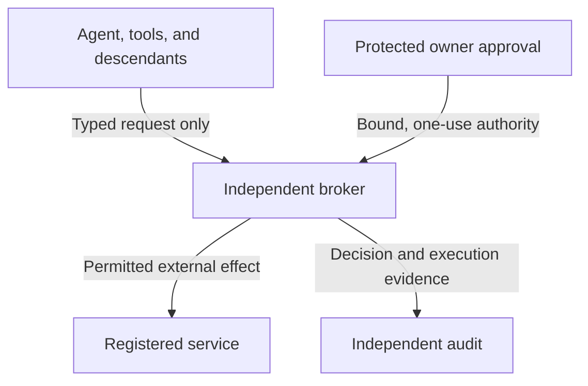

# Agent Containment and Owner Authorization

**Status:** proposed deployment profile. **Namespace:** `ACP` identifies local requirements and assessment items, not new SAF or MITRE techniques.

This profile defines reviewable boundaries for an MCP-enabled agent that can request external work only through an independent broker. The model, tools, descendants, and ordinary workspace remain inside the enclosure. The broker owns external connections; the enrolled owner controls policy changes through a protected approval path.

It applies across SAF Core, MCP, Code-Agent, and Financial-Agent deployments as relevant. These are applicability views of existing mechanisms, not additional canonical framework profiles. Each item states whether its existing SAF classification is a procedure example or related context.

**Package:** 28 attack-assessment items; 34 requirements and planned acceptance tests; 8 proposed mitigations. The canonical SAF technique count and technique evidence states are unchanged.

**Validation boundary:** automated checks validate catalog integrity and repository integration. No secure runtime, cryptographic verifier, telemetry detector, or deployment acceptance test is implemented or field-validated by this package.

## Architecture



The broker enforces policy independently of model judgment. All agent-caused external effects, including remote inference and diagnostic uploads, must be mediated. An approved output remains a disclosure; this profile does not claim that arbitrary output can carry no information.

## Contextual groups

| Boundary group | Attack items | Requirements | New mitigation |
| --- | ---: | ---: | --- |
| [Runtime isolation and complete mediation](groups/isolation.md) | 4 | 4 | [SAF-M-75: Broker-Only Egress and Descendant Containment](../../mitigations/SAF-M-75/README.md) |
| [Broker requests and information release](groups/broker.md) | 4 | 5 | [SAF-M-79: Disclosure-Bounded Tool Brokering](../../mitigations/SAF-M-79/README.md) |
| [Owner identity and protected approval](groups/owner-approval.md) | 4 | 4 | [SAF-M-76: Protected Owner Approval Path](../../mitigations/SAF-M-76/README.md) |
| [One-use approval and authenticated results](groups/one-use.md) | 4 | 5 | [SAF-M-77: Durable Single-Use Action Authorization](../../mitigations/SAF-M-77/README.md) |
| [Policy, enrollment, and recovery lifecycle](groups/lifecycle.md) | 4 | 4 | [SAF-M-78: Enrollment and Policy Lifecycle Integrity](../../mitigations/SAF-M-78/README.md) |
| [Agent identity and bounded delegation](groups/delegation.md) | 3 | 4 | [SAF-M-80: Owner-Separated Agent Delegation](../../mitigations/SAF-M-80/README.md) |
| [Independent audit, shutdown, and recovery](groups/operations.md) | 3 | 4 | [SAF-M-81: Fail-Closed Containment Operations](../../mitigations/SAF-M-81/README.md) |
| [Approval secrets and observation boundaries](groups/proof-privacy.md) | 2 | 4 | [SAF-M-82: Protected Approval Secret Handling](../../mitigations/SAF-M-82/README.md) |

## Attack items by SAF tactic

The local scenario tactic is separate from its linked technique's canonical tactics. `related_context` must not be counted as direct technique coverage. External ATT&CK mappings are analogous and do not change the SAF tactic registry.


### Persistence

| Item | Scenario | Existing SAF context | Relationship |
| --- | --- | --- | --- |
| [ACP-A018](groups/lifecycle.md) | Owner reference substituted in configuration | [SAF-T1206: Credential Implant in Config](../../techniques/SAF-T1206/README.md) | `procedure_example` |
| [ACP-A019](groups/lifecycle.md) | Update activates an older permissive controller | [SAF-T1207: Hijack Update Mechanism](../../techniques/SAF-T1207/README.md) | `procedure_example` |

### Privilege Escalation

| Item | Scenario | Existing SAF context | Relationship |
| --- | --- | --- | --- |
| [ACP-A002](groups/isolation.md) | Inherited host-management channel | [SAF-T1303: Sandbox Escape via Server Exec](../../techniques/SAF-T1303/README.md) | `procedure_example` |
| [ACP-A003](groups/isolation.md) | Delegate with a larger capability ceiling | [SAF-T1302: Agentic Confused Deputy](../../techniques/SAF-T1302/README.md) | `procedure_example` |
| [ACP-A005](groups/broker.md) | Broker destination substitution | [SAF-T1307: Confused Deputy Attack](../../techniques/SAF-T1307/README.md) | `procedure_example` |
| [ACP-A011](groups/owner-approval.md) | Agent-authored approval assertion | [SAF-T1302: Agentic Confused Deputy](../../techniques/SAF-T1302/README.md) | `procedure_example` |
| [ACP-A012](groups/owner-approval.md) | Approved action replaced before dispatch | [SAF-T1302: Agentic Confused Deputy](../../techniques/SAF-T1302/README.md) | `procedure_example` |
| [ACP-A014](groups/one-use.md) | Concurrent verification of one approval | [SAF-T1706: OAuth Token Pivot Replay](../../techniques/SAF-T1706/README.md) | `related_context` |
| [ACP-A015](groups/one-use.md) | Consumed approval restored after a crash | [SAF-T1706: OAuth Token Pivot Replay](../../techniques/SAF-T1706/README.md) | `related_context` |
| [ACP-A020](groups/lifecycle.md) | Recovery used as an owner-approval bypass | [SAF-T1302: Agentic Confused Deputy](../../techniques/SAF-T1302/README.md) | `procedure_example` |
| [ACP-A021](groups/delegation.md) | Agent authority presented as personal owner approval | [SAF-T1302: Agentic Confused Deputy](../../techniques/SAF-T1302/README.md) | `procedure_example` |
| [ACP-A022](groups/delegation.md) | Delegation widened at the next service | [SAF-T1308: Token Scope Substitution](../../techniques/SAF-T1308/README.md) | `procedure_example` |

### Defense Evasion

| Item | Scenario | Existing SAF context | Relationship |
| --- | --- | --- | --- |
| [ACP-A013](groups/one-use.md) | Recorded success reused for another request | [SAF-T1404: Response Tampering](../../techniques/SAF-T1404/README.md) | `procedure_example` |
| [ACP-A016](groups/one-use.md) | Forged remote verifier acceptance | [SAF-T1404: Response Tampering](../../techniques/SAF-T1404/README.md) | `procedure_example` |
| [ACP-A023](groups/delegation.md) | Live approval relayed through the wrong endpoint | [SAF-T1407: Server Proxy Masquerade](../../techniques/SAF-T1407/README.md) | `related_context` |
| [ACP-A024](groups/operations.md) | Approval pressure through repeated requests | [SAF-T1403: Consent-Fatigue Exploit](../../techniques/SAF-T1403/README.md) | `procedure_example` |

### Credential Access

| Item | Scenario | Existing SAF context | Relationship |
| --- | --- | --- | --- |
| [ACP-A009](groups/owner-approval.md) | Counterfeit owner approval interface | [SAF-T1302: Agentic Confused Deputy](../../techniques/SAF-T1302/README.md) | `related_context` |
| [ACP-A010](groups/owner-approval.md) | Owner input captured before protection | [SAF-T1505: In-Memory Secret Extraction](../../techniques/SAF-T1505/README.md) | `related_context` |
| [ACP-A027](groups/proof-privacy.md) | Retired mask allocation returned to service | [SAF-T1207: Hijack Update Mechanism](../../techniques/SAF-T1207/README.md) | `related_context` |
| [ACP-A028](groups/proof-privacy.md) | Private approval legend or decoding state exposed | [SAF-T1505: In-Memory Secret Extraction](../../techniques/SAF-T1505/README.md) | `procedure_example` |

### Command and Control

| Item | Scenario | Existing SAF context | Relationship |
| --- | --- | --- | --- |
| [ACP-A001](groups/isolation.md) | Unbrokered server control channel | [SAF-T1903: Malicious Server Control Channel](../../techniques/SAF-T1903/README.md) | `procedure_example` |

### Exfiltration

| Item | Scenario | Existing SAF context | Relationship |
| --- | --- | --- | --- |
| [ACP-A004](groups/isolation.md) | Background diagnostic disclosure | [SAF-T1910: Covert Channel Exfiltration](../../techniques/SAF-T1910/README.md) | `procedure_example` |
| [ACP-A006](groups/broker.md) | Secret carried in a permitted tool argument | [SAF-T1911: Parameter Exfiltration](../../techniques/SAF-T1911/README.md) | `procedure_example` |
| [ACP-A007](groups/broker.md) | Context forwarded to an outside model | [SAF-T1914: Tool-to-Tool Exfil](../../techniques/SAF-T1914/README.md) | `procedure_example` |
| [ACP-A008](groups/broker.md) | Covert content in an approved report | [SAF-T1902: Response-Borne Covert Channel](../../techniques/SAF-T1902/README.md) | `procedure_example` |

### Impact

| Item | Scenario | Existing SAF context | Relationship |
| --- | --- | --- | --- |
| [ACP-A017](groups/lifecycle.md) | Self-modified containment policy | [SAF-T2103: Code Sabotage](../../techniques/SAF-T2103/README.md) | `procedure_example` |
| [ACP-A025](groups/operations.md) | One-use attempts exhausted to force fail-open recovery | [SAF-T2102: Service Disruption](../../techniques/SAF-T2102/README.md) | `procedure_example` |
| [ACP-A026](groups/operations.md) | Agent removes containment audit configuration | [SAF-T2103: Code Sabotage](../../techniques/SAF-T2103/README.md) | `procedure_example` |

## Requirements and use

1. Select the contextual groups that apply, then implement all requirements needed for the claimed boundary. MUST describes this proposed profile, not a new MCP protocol requirement.
2. Execute the [deployment acceptance plan](VALIDATION.md) using independent observations and authorized control cases. All cases are initially marked planned.
3. Keep the owner, agent, verifier, and broker distinct. Retain request binding, attempt consumption, and downstream execution evidence through crashes and revocation.
4. Record measured limitations and excluded channels. Do not equate a passed catalog check with tested runtime security.

The [machine-readable catalog](catalog.yml) is the source of truth for these indexes. The [source notes](SOURCES.md) and [provenance record](provenance.yml) distinguish standards baselines from original design requirements.

## Optional Rosario–Wang ENI6MA realization

[ENI6MA implementation conditions](ENI6MA.md) describe a candidate protected approval component. This profile remains implementation-neutral: perfect privacy of a specified released exchange does not establish isolation, owner attribution, phishing resistance, or action authorization by itself.

## Repository checks

```bash
python3 scripts/validate-containment-profile.py
python3 scripts/generate-containment-profile.py --check
python3 -m unittest discover -s scripts -p 'test_*.py'
```

[Apply the overwrite package](APPLY.md) when using the changed-files ZIP. Follow the repository's [contribution and DCO rules](../../CONTRIBUTING.md) when committing or submitting the result.

## Version history

| Version | Date | Change | Author |
| --- | --- | --- | --- |
| 0.1 | 2026-09-16 | Initial requirements and contextual assessment proposal | Franciscus Dylan Rosario; Codex drafting assistance |
